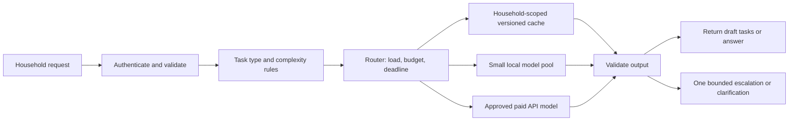

# Hestia multi-model system — Architecture lead

Status: routing design, 350 benchmark evaluations, both 90-row cost tables,
and the five-question baseline/RAG/fine-tuning comparison are integrated.
Person 3's PR #40 is included. The remaining 25 Llama-3.2 evaluations require
model-author access approval (HTTP 403, checked October 25, 2026).
The small classroom SLM experiment is separate from the 15 Hugging Face models.

## Evidence and experiment boundaries

All members use `benchmark_contract.py`, `benchmark_runner.py`, the same 25 prompts,
220 maximum new tokens, greedy decoding and the shared ten-point rubric. Architecture lead
owns SmolLM-360M-Instruct, TinyLlama-1.1B-Chat-v1.0 and Llama-3.2-3B-Instruct.
The last model requires approved Hugging Face access. Failed attempts are recorded
as failures; they cannot establish latency or quality. First-pass automated rubric
scores require inspection against raw responses before final submission.

Architecture lead local status: all 25 SmolLM-360M prompts completed on CPU/float32. Mean
assistant-inspected score is 2.48/10, median latency 19.0588 s and median output
rate 11.4717 tokens/s. Frequent format violations, repetitive role-play and invented
details make this model unsuitable for accepting unvalidated structured tasks in
this run. Inspect `architecture_review_audit.json` for response hashes and scoring notes;
student signoff is pending. This is not a speed comparison against Person 1's MPS.

TinyLlama initially failed to load with Windows paging-file error 1455, then
completed all 25 evaluations on a Google Colab Tesla T4 with float16. Its mean
assistant-inspected score is 2.96/10, median latency 5.2453 s and median output rate
37.7479 tokens/s. Several responses contain useful facts but routinely violate
JSON/single-label requirements, so this run does not qualify it for the proposed
8/10 quality gate. The raw GPU CSV, executed Colab notebook, environment and
response-hash review audit are retained. These timings do not establish that
TinyLlama is faster than CPU SmolLM because the hardware and precision differ.

Llama returned gated
repository HTTP 401 initially; after local authentication, the configuration check
returned HTTP 403 stating the account was not in the authorized list. A separate
three-row partial float16 SmolLM trial is exploratory and
was stopped when observed available RAM dropped below 1 GB (about 95% used).
These failures are retained in the evidence and do not count as successful
benchmarks. `architecture_gpu_benchmark.ipynb` prepares a common CUDA/float16 rerun of
all three models without changing the shared prompts or runner. The latest Llama
check explicitly says the author's access review is pending. Architecture lead now has
50/75 successful evaluations; the remaining 25 require Llama approval.

The runner measures one complete generation, including input prefill and decoding,
excluding model download/loading. Tokens/sec means output tokens divided by that
elapsed time. It is not a sustained multi-user GPU capacity benchmark. There is no
warmup or repeated-trial protocol in the shared runner: retain the common procedure,
label its limits, and do not interpret a single p95 over 25 different prompts as
a production service-level guarantee. Token counts also differ between tokenizers.

Person 1 used Apple MPS. Architecture lead hardware must be recorded separately; CPU, MPS,
and CUDA timings cannot establish an architecture-only speed ranking. Even the same
device label on different machines does not establish equivalent hardware. Compare
quality by model/prompt type, present device-stratified timings, and rerun leading
candidates on one deployment machine before choosing the fastest production model.

`python -m a7.architecture_analysis` validates owner/prompt identities, reports missing,
failed and scored evaluations, and produces summary CSVs. All 15 models need 25
successful reviewed rows each. A category requires all three models (75 rows) before
making a complete category-level claim. Do not call partial results final.

## Proposed architecture

Use explicit rules for the initial router: output schema, number of requested tasks,
context length and dependencies. Long input alone is not proof of complexity. Do not
use a model's verbal confidence as a calibrated probability. Validate JSON, allowed
labels, required fields and task count before accepting structured output. Preserve
user confirmation for actions the application normally requires; generated text
must not claim an appointment, purchase or repair was completed.

Available local candidate roles are Qwen2.5-1.5B for extraction/summarization and
Mistral-7B/NF4 for classification/summarization, based on the current task gates.
Person 3 adds Qwen3-0.6B for summarization, Qwen2.5-3B for classification and
summarization, and Qwen2.5-7B/MLX-4bit for action planning and summarization.
SmolLM-360M and TinyLlama do not qualify for automatic acceptance in this run.
The paid candidate is Llama-3.1-8B-Instruct via Novita/Hugging Face, using Person 3's
reported catalog rates. This is a different model from the gated Llama-3.2 benchmark.
It has not been evaluated on the shared prompts; qualify it before automatic use.

## Five routing scenarios (Steps 3.1–3.3)

All numeric thresholds below are initial design assumptions, not measured optima.
Define local utilization as busy worker slots / configured worker slots. Initial
quality gate: mean assisted-review score at least 8/10 in that task type, with
all required schema checks passing. The small sample needs production validation.

| Scenario | Trigger and routing rule | Local/API choice | Latency effect | Cost effect | Quality control |
|---|---|---|---|---|---|
| Normal household coordination | Classify an errand, summarize a chore, or extract independent tasks. Check household-scoped cache, then route by task-specific qualification. | Qwen2.5-1.5B extraction; Qwen3-0.6B summaries; Qwen2.5-3B or Mistral classification. API escalation requires separate qualification. | Avoids network time on local/cache hits; queueing and target-hardware validation still matter. | Cache avoids generation; API is cheapest under supplied costs, but its candidate needs task qualification. | Validate labels/JSON, retain every user concern, prohibit invented dates. Escalate once or request clarification. |
| Evening household peak | Local utilization exceeds 70% or queue wait exceeds an assumed 2 s. Keep short validated routine requests local and send complex requests to API while its quota/budget permits. | Small local pool; approved API for overflow/complexity. | Reduces local queue growth, but API network and throttling can add delay. | Uses existing local capacity while paying for overflow instead of provisioning for every spike. Savings require measured utilization. | Same validation gates on both paths; expose an honest retry when both are saturated. |
| Complex household plan | Multi-step moving plan or several dependencies. Require planning quality and format gates. | Qwen2.5-7B/MLX-4bit passes the observed planning gate (8.4/10). Qualify the paid API separately; retain review for uncertain priorities. | Single qualified planning pass avoids an extra weak attempt; its observed median is 2.386s on the Mac, not a serving SLA. | API is cheapest in supplied costs, conditional on qualification; local planning is a quality-qualified alternative awaiting deployment-capacity checks. | Check dependency order, constraints, completeness and unsupported claims. A larger parameter count is not a quality guarantee. |
| Budget pressure | Daily API spend reaches 80% of configured budget. Prefer valid versioned cache and qualified local model; reserve remaining API spend for complex/high-urgency cases. | Small local pool first; API only within reserve. | Local processing/cache can be fast; reduced API use can increase local wait. | Enforces a forecast-based spend cap; calculate remaining requests from actual input/output rates. | Never silently lower the minimum quality threshold. Clarify, queue or decline when no qualified route is affordable. |
| Local overload or outage | Local utilization exceeds 90%, repeated local failures, or no healthy worker. Open a circuit breaker and route eligible requests to API. | Healthy local workers for a limited probe; approved API for eligible traffic. | Stops repeated calls to failed workers; bounds retry time. API outage requires queue/retry response. | Temporary API expense is traded against lost requests; cap retries and queue size to limit cost. | Apply identical validators; enforce deadline, provider quota and user-data rules. Recover local traffic gradually after successful health probes. |

Cache keys include household, normalized request, model/prompt version and underlying
task/policy data version. Invalidate after household changes; do not share private
responses between households. Use one escalation maximum to prevent retry loops.
Log route, model/version, input/output tokens, queue/service/network time, validator
result and estimated charge. Operational failures are not low-quality generations.

## Scaling simulations

`results/architecture/routing_simulation.csv` contains 30 planning rows: five scenarios
across all six required traffic levels. These assume one request/user/day and 500
generated tokens/request, solely to demonstrate routing load arithmetic. Cache,
local and API shares are explicit assumptions and sum to one; they are not an
observed traffic distribution. Peak factors of 1 or 4 are illustrative. Replace
these routing shares with measured traffic before operational costing. The shared
cost tables use the same one-request, 256-input/500-output workload, but their
peak factor is 2; the routing simulation's 1/4 factors are separate sensitivity cases.

For D users, r requests/user, h cache fraction and f local share of all requests:
local requests = D r f; API requests = D r (1-h-f). Output token load is requests
times output length. API billing must also count input tokens, including retrieved
context and prompt formatting. Peak requests/sec = D r (1-h) peak_factor / 86400.
Do not convert this into machine counts without a measured concurrent capacity test.

If a small-model attempt is followed by an API escalation on fraction e of local
requests, charge both attempts: local requests remain D r f and API requests gain
D r f e. End-to-end escalated latency includes both service times plus queueing and
network time. The illustrative simulation assumes no escalation and no failures.
It predicts load only; no simulated speed, quality or savings is presented as fact.

## Local versus API cost comparison (Step 2.5)

Both 90-row tables are integrated. API is cheaper in all 90 modeled comparisons
across 1,000–100,000,000 DAU; local is cheaper in none. There is no observed
crossover in the six tested levels. See `results/architecture/cost_comparison.csv`,
`crossover_intervals.csv` (header only because there are no crossings), and
`cost_analysis.md`. The separate zero-gateway price frontier is a sensitivity
analysis, superseded by paired full totals for the actual cheaper-option answer.

Person 3 uses the same Llama-3.1-8B-Instruct/Novita comparable for every local model,
at reported October 23 rates of $0.02/million input and $0.05/million output tokens.
These are supplied historical pricing assumptions, not 15 exact-model API quotes
or evidence of equivalent quality. API inference costs $0.03012 per 1,000 requests.
The separate 2-vCPU gateway costs $1.986667/day per replica, including disk;
50 requests/s is assumed capacity. All 15 API rows therefore tie at each DAU level.
API daily totals rise from $2.016787 at 1k DAU to $3,204.706667 at 100m DAU.
Local totals range from $12.333333–$37/day at 1k DAU; capacity-scaled fleets grow
with load. Eleven local throughput rates are parameter-based estimates and the
T4-to-3090 transfer is unvalidated, so these are planning estimates, not production TCO.
Use the normalized input contract in `architecture/README.md`; preserve their original
tables and record each conversion. Both tables must use the same workload,
input/output token lengths, currency, day length and traffic counts.

For each model with measured effective output capacity c tokens/s per serving
replica, target utilization u and peak multiplier p, planning replicas are
ceil(D r output_tokens p / (86400 c u)). A replica may require multiple GPUs/nodes;
price that complete configuration and verify model memory fit. Batch-1 benchmark
tokens/sec is only a labeled rough proxy for c, not validated concurrent capacity.
Add storage, CPU/frontend, data transfer and other explicitly included costs.

API daily inference cost = D r (input_tokens * input_price_per_token +
output_tokens * output_price_per_token), plus API frontend machines and included
network/storage costs. API frontend machines are application servers, not local
model-serving GPUs. Keep actual prices distinct from stated assumptions.

The comparison code computes local minus API daily totals and reports all changes
in the cheaper option between adjacent traffic levels. Machine counts use ceilings,
so several crossings are possible. A change between 10k and 100k DAU only brackets
a crossover; it does not prove an exact DAU threshold. If no sign changes, report
no observed crossover within the six tested levels.

Under the simplified assumptions of one fixed local machine costing F/day, API
fixed overhead A/day and inference cost v/request, break-even requests are
(F-A)/v for v>0, provided the result is positive and within that machine's
capacity. This approximation stops applying when another local machine is needed.

The three required answers from `cost_comparison.csv` are:
(1) local is cheaper in none of the 90 modeled cases; (2) API is cheaper for every
local-model alternative at all six tested traffic levels; (3) the present cost
case favors API at launch and scale, conditional on acceptable quality, quotas and
latency. Switch only when revised sustained predicted savings exceed
migration/operation costs and both latency and quality gates pass. Use API overflow
during temporary peaks and re-evaluate after workload/provider changes. There is
no defensible universal claim that local becomes cheaper above a particular DAU.

## Performance analysis (Step 1.6)

The updated fourteen-model/350-response findings are in
`results/architecture/performance_findings.md`. Mistral-7B has the highest available
mean score (8.12/10) in the T4/NF4 condition. Large is the highest fully observed
bin (75/75, mean 7.5867); Small is 5.6933, Compact 3.84, Ultra-light 1.9733.
Medium has 50/75 rows and mean 6.36; Llama is missing. These observations do not establish a complete
five-category ranking or isolate size from quantization and training differences.

The available task-level quality/format gates qualify Qwen2.5-1.5B for extraction
and summarization, and Mistral-7B/NF4 for classification and summarization.
Qwen3-0.6B qualifies for summaries (9.6/10); Qwen2.5-3B qualifies for classification
(10) and summaries (9.2); Qwen2.5-7B/MLX-4bit qualifies for action planning (8.4)
and summaries (9.0). No available model passes the current gate for priority prediction.
Therefore the router must clarify, queue for review, or use an independently
qualified API model for those tasks; it must not silently choose an unqualified
small model merely because it is cheaper. The API target is priced but remains
unqualified on the shared 25 prompts. These candidates
must be retested on the planned serving hardware before deployment.

Within the supplied Person 1 subset, the 100-row CSV reports mean scores of 7.56 for
Qwen2.5-1.5B, 7.32 for Phi-3.5-mini, 3.84 for SmolLM2-360M and 2.28 for distilgpt2.
According to those supplied rubric scores, larger models did not always win:
Qwen2.5-1.5B scored 10 versus Phi-3.5-mini's 7 on `extraction-02`, and 10 versus 1
on `priority-05`. These are examples from the available evidence, not a final
15-model ranking. Audit the raw responses and scoring notes before submission.
Qwen2.5-1.5B also has a lower median latency than Phi on Person 1's common MPS
environment (1.5895 s versus 5.3627 s), so it is the stronger balance candidate
within that four-model subset. A global speed winner and best complete size
category remain pending the remaining team evidence and comparable hardware runs.

Use all reviewed outputs to answer which category gives the best mean quality;
report per-model and per-task scores, score counts, and category completeness.
Check whether any smaller model outperforms a larger model on the same prompt
before answering whether larger models always perform better. Quality is a human
rubric assessment; heuristic keyword scores alone are insufficient evidence.

For speed/quality balance, first require the task quality threshold, then compare
latency and throughput among qualifying models tested on the same hardware/settings.
Report the Pareto frontier rather than declaring a winner from incomparable devices.
The 350 available rows support provisional findings, not a complete 15-model result.
Within Person 3's same MPS/float16 condition, Qwen3-0.6B summaries score 9.6
at median 1.2654s, versus Qwen2.5-3B's 9.2 at 5.7808s, supporting the smaller
summary candidate. Do not compare those latencies with Person 1's different Mac
or the 7B MLX/4bit run. Use Qwen2.5-7B as the new action-planning candidate in
the complex-plan scenario; retain review/clarification for unqualified priority outputs.

## Assignment 2: baseline, RAG and fine-tuning

Person 2's actual five-question baseline and 20 RAG outputs are now integrated into
`slm/architecture_comparison.ipynb`, the submitted SLM notebook's Markdown section,
and `results/architecture/slm_comparison.md`. All baseline/RAG factual accuracy
scores are 1/10; no retrieved household fact was answered correctly. Top-K=1 is
selected by the documented lower-K tie rule. Four of five selected RAG continuations
differ from baseline, but response change does not establish factual improvement.
At Top-K=1 only the laundry and trash facts survive in full in the initial visible
context; at K=2,3,5 none of the five complete expected facts survives.
Person 3's five pre-training baselines match exactly. Fine-tuning uses 10 examples
including these same five evaluation questions, so this is an in-sample comparison.
Reported 300-step training reduces loss 4.6915 to 0.2225 and changes the state hash.
On continuation-level review, fine-tuning averages 2.4/10 accuracy and 3.6/10
relevance versus 1/10 for baseline and selected RAG. It is the relative accuracy
winner here, but none of its five outputs is wholly correct and contradiction-free;
all contain unsupported information. Raw phrase-match scores gave Q3/Q4 10/10
despite mixed correct/wrong facts; those scores remain preserved separately.

Independent retraining from the original checkpoint reproduces 4/5 continuations
exactly, with a different final tensor hash and Q4 continuation on Windows versus
Person 3's Mac. Local loss ends at 0.2220 and weights change. This establishes
recipe reproducibility with a documented cross-platform limit, not byte-identical
fine-tuned checkpoint verification. Source exports remain unchanged; see
`results/architecture/finetune_reproduction_check.json`.

See `slm/architecture_comparison.ipynb`, whose Markdown comparison table belongs in the
submitted SLM notebook. Use Person 2's five exact questions and facts, not new
questions invented for this analysis. All conditions originate from the original
checkpoint state hash in `slm/results/selected_checkpoint.json`.

Use CPU, two threads, seed 42 per question, temperature 0.7 and 100 new characters.
Return continuation only in every comparison cell. Preserve the exact prompt
string as well as the question; identical normalization must be documented.
Only the final 32 input characters reach the SLM at its first prediction. Record
the visible suffix for each RAG input and which supporting facts survived. Never
enlarge embeddings or replace generated text with retrieved factual answers.

Choose the final RAG Top-K using an explicit rule: highest mean quality across the
same five questions, with ties resolved by lower K. This is descriptive selection
on the evaluation set, not an unbiased held-out performance estimate. Show all
20 retrieval results as supporting evidence and disclose this selection limitation.
For stronger generalization claims, select K on a separate development set.

Assess factual accuracy against the knowledge documents, relevance to the question,
unsupported claims and consistency across the five outputs. Identical seed makes
runs reproducible; it does not measure variation across seeds. If discussing that
kind of consistency, add identical repeated-seed trials for all three conditions.

Final analysis currently supports these methodological answers: fine-tuning updates
weights; RAG should preserve them; external document updates avoid model retraining;
RAG and fine-tuning can be combined, though that is outside this three-condition
experiment. Fine-tuning has the highest reviewed accuracy on this small in-sample
set, but remains unsuitable for reliable answers without further work.
For frequently changing policies, retrieval is the maintainability-oriented design,
but this 32-character classroom SLM may fail to use the facts. Base the observed
quality conclusion on its actual output, even if neither treatment improves it.
