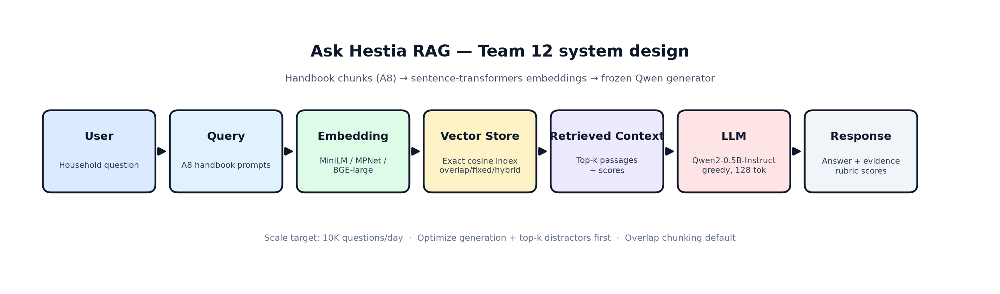

# Ask Hestia · RAG analysis (Assignment 8)

Team 12 · Hestia. Analysis for Parts 2–4. Measured runs are in
`results/person3/` (45 matched generations) and `results/person2/` (retrieval +
scaling). The executable matrix is `rag_system.ipynb`.

**Frozen stack.** Generator `Qwen/Qwen2-0.5B-Instruct` (A6/A7-evaluated), greedy
decoding, 128 new tokens, CPU, four PyTorch threads. Encoders:
`all-MiniLM-L6-v2` (384-d), `all-mpnet-base-v2` (768-d), `BAAI/bge-large-en-v1.5`
(1,024-d). Handbook: 30 paragraphs / 2,901 words (`full`); scaling subset: 15
paragraphs / 1,461 words (`small`). Chunkers: fixed (140-word sentences),
overlap (two adjacent paragraphs), hybrid (topic-bounded 240-word packs).

---

## Part 2 · Experiments

### Step 2.1 · Test queries

Five realistic household questions with answer keys are in `data/queries.json`
(Q1 kitchen close + running dishwasher, Q2 grocery outage, Q3 cordless drill
checkout, Q4 bathroom drip report, Q5 guest-room readiness).

### Step 2.2 · Evaluation table

The complete 45-row table (3 encoders × 3 chunkers × 5 queries) with **retrieved
chunks**, answers, context quality, answer quality, latency and notes is
`results/person3/evaluation.csv`. Raw prompts and hit lists are in
`results/person3/{small,medium,large}/rows.jsonl`.

Large-encoder rows (Person 4 focus, filter `size=large` in that CSV):

| Embedding | Chunking | Query | Context quality | Answer quality | Retrieval ms | End-to-end s | Notes (abbrev.) |
|---|---|---|---:|---:|---:|---:|---|
| BGE-large 1024 | fixed | Q1 | 100 | 33.33 | 97.6 | 2.21 | Card done; Running tag incomplete |
| BGE-large 1024 | fixed | Q2 | 100 | 0 | 81.4 | 1.07 | Closes grocery entry instead of Out of stock |
| BGE-large 1024 | fixed | Q3 | 100 | 0 | 84.5 | 4.13 | Misses blue bin / full checkout |
| BGE-large 1024 | fixed | Q4 | 100 | 50 | 62.4 | 4.86 | Partial plumbing report |
| BGE-large 1024 | fixed | Q5 | 100 | 20 | 76.2 | 2.61 | Supplies only |
| BGE-large 1024 | overlap | Q1 | 100 | 100 | 90.0 | 4.48 | Complete kitchen-close answer |
| BGE-large 1024 | overlap | Q2 | 100 | 100 | 84.5 | 3.29 | Unchecked + Out of stock |
| BGE-large 1024 | overlap | Q3 | 100 | 0 | 97.7 | 3.49 | Redirects return to upkeep list |
| BGE-large 1024 | overlap | Q4 | 100 | 100 | 63.4 | 4.41 | Full plumbing workflow |
| BGE-large 1024 | overlap | Q5 | 100 | 100 | 77.5 | 5.12 | Full guest checklist |
| BGE-large 1024 | hybrid | Q1 | 100 | 0 | 105.1 | 2.16 | Invents maintenance card + service call |
| BGE-large 1024 | hybrid | Q2 | 100 | 0 | 93.7 | 1.01 | Treats item as purchased |
| BGE-large 1024 | hybrid | Q3 | 100 | 25 | 99.1 | 3.49 | Bin only; incomplete checkout |
| BGE-large 1024 | hybrid | Q4 | 100 | 0 | 64.0 | 4.52 | Wrong time field; omits Plumbing card |
| BGE-large 1024 | hybrid | Q5 | 100 | 100 | 76.1 | 5.00 | Full guest checklist |

Scores are AI-assisted under `person3/RUBRIC.md`.

### Step 2.3 · Compare embedding models

| Encoder | Dims | Mean context % | Rank-1 support | Mean answer | Median retrieval | Median request |
|---|---:|---:|---:|---:|---:|---:|
| MiniLM | 384 | 100 | 15/15 | 37.44 | 9.1 ms | 4.73 s |
| MPNet | 768 | 100 | 15/15 | 33.33 | 27.8 ms | 4.11 s |
| BGE-large | 1024 | 100 | 15/15 | 41.89 | 84.5 ms | 3.49 s |

**Retrieval.** Embedding size did not change quote coverage or first-support rank
on these five queries: every encoder already retrieved every required span in the
top three hits.

**Answer quality.** Larger did **not** always win. BGE’s mean is highest, but MPNet
scored below MiniLM. On kitchen-close with fixed chunks, MiniLM 66.67 > BGE 33.33
> MPNet 0. Dimension alone cannot explain quality: training differs, and the
0.5B generator can ignore evidence. Retrieval latency rose with encoder size;
end-to-end medians did not, because generation dominates.

### Step 2.4 · Compare chunking strategies (large encoder)

Holding BGE-large and the generator fixed:

| Strategy | Mean answer | Median | Perfect / zero |
|---|---:|---:|---|
| fixed | 20.67 | 20 | 0 / 2 |
| **overlap** | **80.00** | **100** | **4 / 1** |
| hybrid | 25.00 | 0 | 1 / 3 |

**Which worked better?** Overlapping paragraphs. They keep a policy sentence with
its surrounding constraints (for example Out of stock with “leave unchecked”).

**Retrieval relevance.** Context quality was already 100% for all three chunkers
on the large encoder. Chunking changed packing and distractors, not whether the
answer key entered the top-k set.

**Final answers.** Fixed splits often put the critical quote in hit 2 while hit 1
emphasized a neighboring rule (Q2). Hybrid pulled appliance-upkeep text into the
kitchen-close prompt (Q1). Overlap produced four complete answers and one miss
(Q3). Prefer overlap for this handbook + small generator stack.

### Step 2.5 · Data scaling

Person 2 completed a separate Colab CPU run with MiniLM + hybrid + k=3 and
compared `small` (15 paragraphs / 10 chunks) with `full` (30 paragraphs / 20 chunks).
The generator revision, prompt, greedy decoding, 128-token cap, CPU float32,
four-thread setting and recorded environment match across both datasets.

| Dataset | Evidence coverage | Mean answer /100 | Reviewed irrelevant chunks | Median retrieval | Median full request |
|---|---:|---:|---:|---:|---:|
| small | 100% | 35.00 | 40% | 39.26 ms | 35.97 s |
| full | 100% | 40.00 | 40% | 35.85 ms | 31.82 s |

Supporting sources remain at rank one, and all reference quotes remain in the top
three. Added neighboring topics change lower-ranked hits on four queries without
changing the reviewed noise fraction. Relevant approval/hand-off context is not
classified as noise merely because it lacks a reference quote.

The five-point mean answer difference comes only from Q3 (0 to 25): the smaller-set
answer invents a green kitchen tool bin; the full-set answer returns the kit to the
correct blue hallway bin but still omits facts. The aggregate ordering is sensitive
to grading the small grocery answer's “checked out” wording: removing its unsupported
status deduction changes the small mean to 45. These five questions do not establish
a general quality or latency benefit from larger data. Timings are individual warmed
requests in dataset order, with variable-length generation; they are not a repeated
load test. Do not pool this Colab timing environment with the Mac comparisons above.

Complete raw prompts/contexts/answers, hash-bound AI-assisted reviews and paired
results are in `results/person2/completed-2026-11-09/`. See
`person2/FINDINGS.md` and `person2_retrieval_scaling.ipynb`. Student signoff is not
recorded. The earlier Mac retrieval-only results remain historical evidence rather
than being relabeled as these new end-to-end requests.

---

## Part 3 · Failure analysis and improvement

### Step 3.1–3.2 · Three failures and root causes

#### Failure 1 — Hallucinated service call (`large` / `hybrid` / Q1)

- **Observed:** Invented an “appliance maintenance card” and a service technician
  despite Kitchen Close + Running-tag evidence in hits 1–2.
- **Root cause:** **Chunking + generation.** Hit 3 (`hybrid-maintenance-03`) is a
  neighboring-topic distractor admitted by hybrid packing. Not an embedding miss
  (context quality 100%). Not a bad query.

#### Failure 2 — Wrong grocery action (`large` / `fixed` / Q2)

- **Observed:** “Record … before closing it” instead of leave unchecked + Out of stock.
- **Root cause:** **Chunking + generation.** Fixed cuts placed the outage quote in
  hit 2; hit 1 emphasized substitute/purchase language. Embedding still retrieved
  the quote. Query is correctly scoped.

#### Failure 3 — Incomplete drill checkout (`large` / `overlap` / Q3)

- **Observed:** Omits borrower name, blue bin and closing the entry; points at
  appliance upkeep for return.
- **Root cause:** **Generation** (instruction following under a short answer style).
  Retrieval already had the blue bin and checkout fields. Overlap chunking is not
  the primary fault—the other four overlap answers scored 100.

### Step 3.3 · One improvement (before / after)

**Change:** top-k 3 → 2 on `large/full/hybrid/Q1` only. Generator, prompt,
decoding, encoder and chunk texts frozen. Removes distractor
`hybrid-maintenance-03`.

**Before (score 0):**

> I marked the completed Kitchen Close card on the household task board. The
> dishwasher should be marked as "Running" on the appliance maintenance card.
> The resident should contact the appliance service technician to have the
> machine serviced.

**After (score 33.33):**

> I marked the Kitchen Close card as complete on the household task board. To
> avoid creating a second closing card for the same evening, I should remove
> the Running tag from the dishwasher.

| | Before | After |
|---|---|---|
| Answer quality | 0 | 33.33 |
| Service-call invention | yes | no |
| Kitchen Close fact | confused | present |
| Running tag / morning unload | missing / wrong | still incomplete |

Partial gain confirms the distractor diagnosis without claiming top-k=2 fixes
every missing fact.

---

## Part 4 · System design reflection

### Step 4.1 · Cost awareness

| Factor | Cost / latency effect in this system |
|---|---|
| **Embedding size** | Index build and query encode grow with dimension (MiniLM ~9 ms vs BGE ~85 ms median retrieval). Storage for 20×1024 float32 vectors is still tiny vs model weights. |
| **Chunk size / strategy** | More/longer chunks → more vectors at build time and slightly longer prompts. Overlap reduced answer failures more than it changed retrieval ms. |
| **Top-k** | Each extra passage lengthens the prompt and can introduce distractors (Failure 1). k=2 was enough for gold coverage on the measured cases and removed one hallucination. |
| **Generation** | Dominates end-to-end time (~seconds) and would dominate paid token cost if hosted. |

### Step 4.2 · RAG vs fine-tuning vs pure prompting

| Approach | When to use for Hestia |
|---|---|
| **RAG** | Household policies that change; need citations; keep generator swappable. Default here. |
| **Fine-tuning** | Stabilize format/style once facts are retrieved or known. A7 SLM still mixed facts after tuning—do not replace retrieval. |
| **Pure prompting** | Only when answers are already in the base model. Fails for local handbook rules (Running tag, Out of stock). |

### Step 4.3 · Design for 10K users/day

Project-specific system diagram (same RAG stages as the brief, labeled with this
team’s stack):

| Stage | Hestia tech stack |
|---|---|
| User | Household member with a chores / shopping / tools / maintenance / guest question |
| Query | Natural-language text; five fixed evaluation queries in `data/queries.json` |
| Embedding | Free Hugging Face sentence-transformers: MiniLM (384), MPNet (768), BGE-large (1024) |
| Vector Store | In-memory exact cosine index over A8 handbook chunks (`fixed` / `overlap` / `hybrid`) |
| Retrieved Context | Top-k passages with scores (k=3 in the matrix; k=2 in the distractor fix) |
| LLM | Frozen A6/A7 model `Qwen/Qwen2-0.5B-Instruct`, greedy decode, 128 new tokens |
| Response | Generated answer + retrieved evidence; scored with the shared rubric |

**How it scales to 10K users/day.** Average load is only ~0.12 questions/s. One
small CPU/GPU generation worker covers the mean; add a second replica for peaks.
The vector store stays tiny (tens of handbook chunks), so search is not the
bottleneck—generation is.

**What to optimize first.** (1) Generation quality/latency or a stronger local
generator after re-qualification. (2) Top-k / distractor control (hybrid Q1).
(3) Keep overlap chunking as the default packer. (4) Version the index on handbook
edits. Do not auto-execute chores from generated text without Hestia confirmation.

---

## Limits

Five queries, one small generator, CPU timings, AI-assisted scores. Do not claim a
universal ranking of embedding dimension or chunking. Rebuild comparison CSVs with
`python -m a8.person3_analysis` (no model download).
