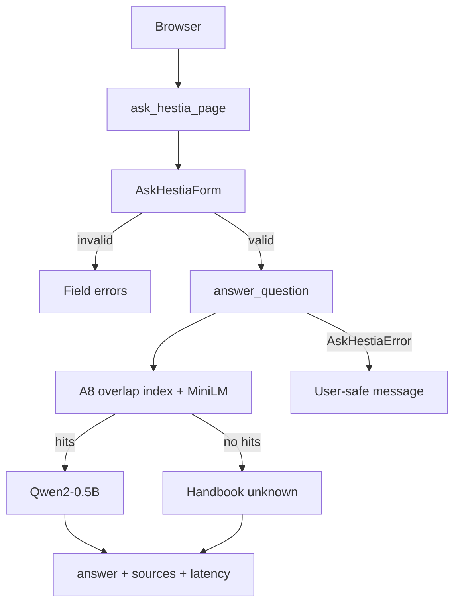

# Assignment 9 · AI system design (Steps 2.1–2.3)

## Step 2.1 · AI workflow write-up

| Stage | What happens in Hestia |
|---|---|
| **User input** | Signed-in member submits a household question on `/tasks/ask/` (≤500 characters). |
| **Preprocess** | `AskHestiaForm` trims and validates; empty / oversize never reach the model. Page requires login (`@login_required`). |
| **Models** | MiniLM embeds the query; A8 **overlap** handbook chunks are scored with cosine similarity; top-2 hits with score ≥0.30 are kept. If none qualify, abstain without calling the LLM. |
| **Generation** | `Qwen/Qwen2-0.5B-Instruct` (A6/A7-tested) receives system instruction + ranked passages + question; greedy decode, 128 new tokens, 45 s cooperative cap. |
| **Return to user** | Django template shows answer text, source passages (id, section, text) and `latency_seconds`. `AskHestiaError` maps to a safe page message. |

Service entrypoint: `workflows.services.ask_hestia.answer_question(question)`.

## Step 2.2 · Architecture diagram

Hestia-specific Django RAG pipeline (tech stack on each stage):

Django wiring:

## Step 2.3 · Model selection rationale

Built from A6/A7 benchmarks and the **completed** A8 evidence (Person 3’s 45-row
Mac matrix + Person 2’s Colab MiniLM matrix/scaling under
`a8/results/person2/completed-2026-11-09/`):

- **Generator:** Qwen2-0.5B from A6 household runs and A7 T4/NF4 scores (5.20/10,
  1.49 s median) vs SmolLM2-360M (3.32/10) and Mistral-7B (8.12/10 but 4.18 s /
  larger memory). Chosen for local fit + prior evidence, not as the absolute
  quality winner.
- **Embedder:** MiniLM. All three A8 encoders already hit 100% quote coverage on
  the five handbook queries; Person 2’s finished MiniLM Colab matrix repeats that
  ceiling (15/15, mean answer 37.44). Larger encoders mainly cost encode/load time.
  Transformers mean pooling reuses Hestia’s HF loading path without
  `sentence-transformers` in Django.
- **Chunking:** Overlap. Ranking agrees across slices—MiniLM Colab means
  17.33 / 40 / **55** (fixed / hybrid / overlap) and BGE Mac means
  20.67 / 25 / **80**. A9’s page before/after (fixed → overlap) raised mean
  completeness 14% → 45.67% with Q4 fully correct.
- **Top-k=2:** A8 hybrid Q1 distractor test—removing the third hit eliminated the
  service-call hallucination. Person 2 scaling showed more paragraphs alone are
  not a robust quality fix (35 → 40 mean, Q3-only, scoring-sensitive).
