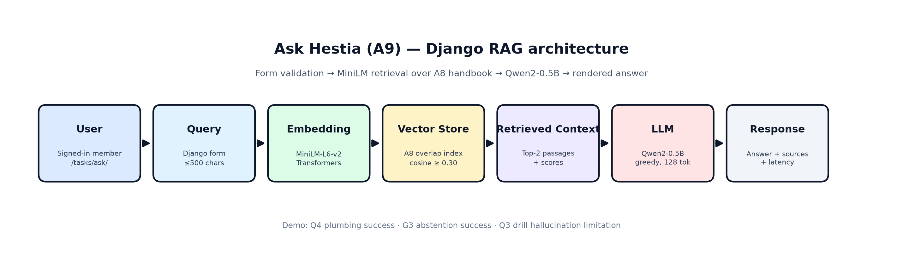
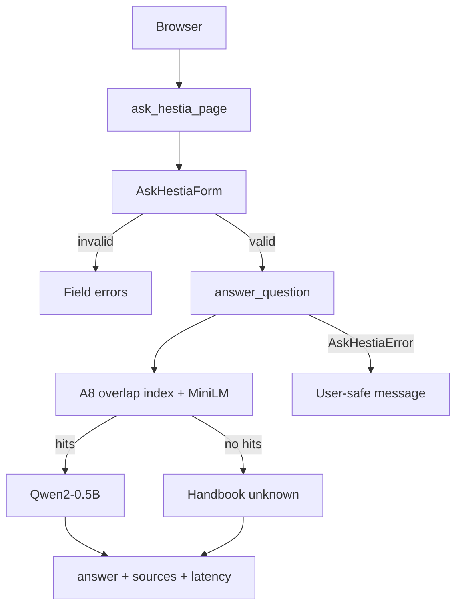

# Assignment 9 · AI system design (Steps 2.1–2.2)

## Step 2.1 · AI workflow write-up

| Stage | What happens in Hestia |
|---|---|
| **User input** | Signed-in member submits a household question on `/tasks/ask/` (≤500 characters). |
| **Preprocess** | `AskHestiaForm` trims and validates; empty / oversize never reach the model. |
| **Models** | MiniLM embeds the query; overlap handbook chunks are scored with cosine similarity; top-2 hits with score ≥0.30 are kept. If none qualify, abstain without calling the LLM. |
| **Generation** | `Qwen/Qwen2-0.5B-Instruct` (A6/A7-tested) receives system instruction + ranked passages + question; greedy decode, 128 new tokens, 45 s cooperative cap. |
| **Return to user** | Django template shows answer text, source passages (id, section, score, text) and `latency_seconds`. `AskHestiaError` maps to a safe page message. |

Service entrypoint: `workflows.services.ask_hestia.answer_question(question)`.

## Step 2.2 · Architecture diagram

Hestia-specific Django RAG pipeline (tech stack on each stage):

Django wiring:

## Step 2.3 · Model selection rationale

Documented for graders in `README_AI.md` and `docs/a9-ask-hestia-backend.md`:

- **Generator:** Qwen2-0.5B from A6 household runs and A7 T4/NF4 scores (5.20/10, 1.49 s median) vs SmolLM2-360M (3.32/10) and Mistral-7B (8.12/10 but 4.18 s / larger memory). Chosen for local fit + prior evidence, not as the absolute quality winner.
- **Embedder:** MiniLM from A8 small encoder; Transformers mean pooling reuses Hestia’s HF loading path without requiring the `sentence-transformers` package in Django.
- **Chunking:** Overlap selected after Person 3’s integrated before/after evaluation (mean completeness 14% → 45.67%; Q4 fully correct).
