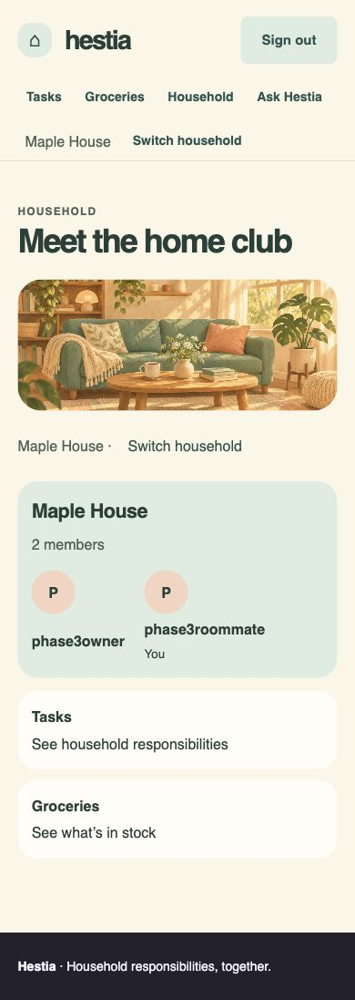

# Phase 3 — roommate invitations and joining

Implemented on `household-invitations` from clean Phase 2 commit `60166e4` in `/Users/darshan/Documents/Projects/12_HestiaaAI-household-demo`. The original/grading checkout and its database were not copied, seeded or migrated. No push, deployment, PR, main merge, external collaborators or coauthor attribution. No subagents.

Owners can issue, copy a new link once, inspect status/expiry, reissue and revoke pending invitations in the selected household. The intended recipient signs up/signs in, verifies the matching allauth address and explicitly joins. Joining selects that household and exposes its existing task/grocery/roster experience. Ask Hestia, AI approval, isolation and onboarding remain intact. Member removal, ownership transfer, role editing and expenses remain outside this phase.

## Commits and implementation

- `85f0e36` — transactional digest-only model/services, seven-day validity, permission/reset/replay/rollback/concurrency tests, migration 0002.
- `3789948` — selected-owner forms/routes, nonce/rates, private generic acceptance, real allauth signup/verification/login continuation and explicit join.
- `05ae2ff` — after-commit mail/recovery, durable nonce migration 0003, request/log privacy, account freshness and verification-action guards, local CSRF-compatible private form submission and regression tests.
- This documentation commit — current route/form/security contract, evidence and README.

Principal files: `households/models.py`, `services.py`, `invitation_views.py`, `invitation_acceptance.py`, `invitation_continuation.py`, `invitation_mail.py`, `invitation_privacy.py`, `account_adapter.py`, `access.py`, `forms.py`, `urls.py`, migrations 0002/0003, invitation templates, roster owner link, `static files/js/invitation-forms.js` and settings. Five invitation test modules cover the new behavior. [Current route/form contract](household-access-contract.md) defines exact request fields and response policies.

## Checks and counts

All application tests used SQLite in-memory test databases. AI/network calls remained mocked/offline (`HF_HUB_OFFLINE=1`, `TRANSFORMERS_OFFLINE=1`); no live inference/provider request was part of this proof.

| Required check | Baseline | Final |
|---|---|---|
| `python manage.py check` | no issues | no issues |
| `python manage.py makemigrations --check --dry-run` | no changes | no changes |
| `python manage.py test households workflows inventory api reports analytics --noinput` | 227, OK | 273, OK, 1 skipped; 18.659s |
| `python manage.py test --noinput` | 271, OK | 317, OK, 1 skipped; 17.066s |
| `git diff --check` | clean | clean |

“317” includes the skipped test: 316 executed successfully. The additional 46 tests include one PostgreSQL-only concurrency test. It did **not** run here. SQLite success does not prove PostgreSQL row-lock behavior. Run `households.test_invitations.InvitationConcurrencyTests` with a disposable PostgreSQL database before relying on production concurrency evidence.

Performance tests retained exactly 5 queries for the task board, 3 for household selection and 5 for Insights across 10/1,000 tasks and 1/20 memberships. Startup, product archive, account/OAuth, task/grocery, export/isolation, AI approval and Ask Hestia tests passed in the complete suite. No budget or test was disabled to pass.

Regression coverage includes stale/inactive/null-user owners, roommates/outsiders, dual-household selection, foreign IDs, forged fields/nonces, trusted link origin, case-normalized recipients, verified secondary addresses, unverified/mismatched identities, expiry boundary, malformed/revoked/used tokens, repeated acceptance, historical elevated inactive reset, preserved active owner membership, account/verification loss between preview and mutation, transactional rollback, one-use nonce replay even after cache loss, real CSRF for issue/reissue/revoke/accept, rejected cross-origin submissions, rate limits and post-join A/B data isolation. Verification requests cannot accidentally accept an invitation, including requests from already-verified users.

Mail tests prove locmem recipient/body/link, deferred callback, rollback cancellation, suppression of superseded pending callbacks and SMTP failure recovery without invalidating the committed invitation. Actual autocommit view tests distinguish failed from queued delivery. Redaction tests cover raw and encoded bearer paths, recipient/request/exception data, console suppression and preservation of the live request.

## Disposable migration proof

A separate `/tmp/hestia-phase3-migration-proof.sqlite3` was created with all compatible application migrations and household 0001. A pre-existing user, workspace and OWNER membership were inserted before applying household 0002/0003. The proof then:

1. Applied 0003 through 0002; original workspace/membership IDs, role, display name and source-management permission were unchanged.
2. Inserted an invitation with token/request digests.
3. Rolled households back to 0001; invitation table disappeared and original workspace/membership fields remained unchanged.
4. Reapplied 0003; original records remained, with an empty invitation table.

Migration 0002 adds the invitation table and changes only the ADULT display label to Roommate. Migration 0003 adds nullable unique `request_digest`; existing invitation rows remain valid with null nonce digest. Rolling back to 0001 deliberately discards invitation history/links; this is not a way to retain invitations while removing the feature. Existing household/member data is preserved. No grading/product database migration was performed.

## Browser evidence

Used the in-app browser with disposable `/tmp/hestia-phase3-preview.sqlite3`, local server port 8027 and Django's file email backend writing only to a private temporary fixture directory. Owner cookies used `127.0.0.1`; recipient cookies used `localhost`, giving separate simultaneous account sessions. The trusted email/copy origin was explicitly `http://localhost:8027`. No admin-created recipient membership or verification flag bypass was used.

Verified through visible UI:

1. Seeded owner logs in, sees Maple House's existing “Water the balcony plants” task, opens roster → Invite roommates.
2. Owner enters intended recipient and submits using Tab/Return. Response shows a readonly copyable new link and pending status. Link is read from that visible textarea and opened in the independent anonymous recipient session.
3. Generic invitation preview reveals no household name or recipient. Recipient chooses Create an account, signs up and reaches mandatory verification.
4. Opened the actual confirmation URL captured by the disposable file email backend. GET displayed Confirm; Verify email POST verified and returned to the invitation. Sign-in continuation preserved the destination.
5. Verified recipient sees Maple House plus explicit Join household. Return activates the join button; task board shows the original task in the selected household. A harmless repeated acceptance also displayed the welcome message without duplicating membership.
6. Recipient sees the fixture Oat milk grocery batch, the two-member owner/roommate roster, and Insights with exactly one task. Owner session remains separate and sees Accepted status. Roommate roster has no owner invitation action.
7. Opening the invitation in the owner (wrong email) session shows a clear different-account explanation and POST sign-out control; GET leaves the owner signed in. Full POST sign-out/login continuation also has an automated regression test.
8. Reissue pending fixture invitation through owner UI; old link becomes generic invalid. New link reaches identity checking. Revoke that new invitation; it then becomes generic invalid. Expired fixture link is likewise generic invalid.
9. Acceptance and joined roster were visually inspected at 390×844; navigation wraps, confirmation/button and roster are readable without horizontal overflow. Owner form/status view was also visually inspected at the default width. Keyboard issue and explicit join worked; revoke/reissue used visible buttons.

The browser exposed native no-referrer form POSTs sending `Origin: null`, correctly rejected by Django CSRF. The final implementation uses a local CORS-mode fetch handler with normal CSRF fields and real same-origin Origin; no null-origin allowance or CSRF exemption was added. Browser checks confirmed issue, join, reissue, revoke, redirects/messages and keyboard operation after this fix. JavaScript is required for private invitation form submission; a noscript explanation is rendered. A named `action` input was also verified through the acceptance form so it cannot shadow the handler's target URL.

## Security and deployment decisions / limits

Only SHA-256 invitation token digests persist. Issuance has 32 random bytes, seven-day expiry and current owner/transaction checks. Raw links appear only in new issue/reissue responses and intended email; temporary local continuation paths are necessary for allauth navigation and never authorize membership. New/reactivated members receive ordinary Roommate permissions; accepted/revoked/expired links cannot restore removed access. No repository/service access is granted.

Email is queued only after commit. Console delivery of private invitation/verification content is suppressed, with copy recovery and honest failure messages. Locmem/file/SMTP mocks prove application behavior, **not** real inbox delivery. Real SMTP credentials, delivery/retries/bounces and provider integration were not exercised.

Configure trusted `ACCOUNT_PUBLIC_ORIGIN`, a private Django mail backend and a shared atomic cache in multi-worker deployment (local-memory throttles are per process). Configure HTTPS/secure cookies. Django default log handlers redact raw/encoded invitation paths, private recipient/request data and secret traceback locals; application filtering does not cover proxy/CDN access logs, APM/tracing, third-party email backends or custom logging handlers. Redact bearer paths and encoded invitation continuations there and disable body/cookie capture. Invitation pages use private/no-store/no-referrer, local assets, noindex and restrictive acceptance CSP.

PostgreSQL concurrency remains unproven in this environment; its test is present and explicitly skipped on SQLite. Production HTTPS/browser matrix, real SMTP/provider delivery and operational proxy/APM redaction remain deployment evidence items. No push/deployment was attempted.
