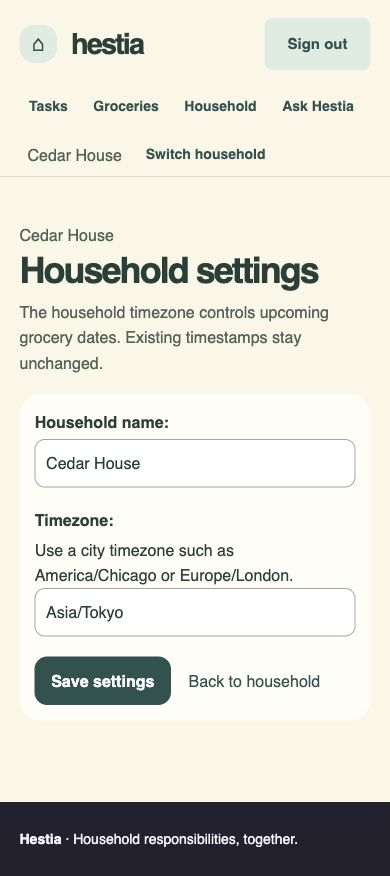

# Phase 4 — household settings and member management

Implemented 2026-11-11 in `/Users/darshan/Documents/Projects/12_HestiaaAI-household-demo`, branch `household-member-management`, starting from the latest local `household-invitations` commit `42a7121`. Existing unrelated `.gitignore` and `docs/superpowers/plans/2026-11-09-household-phases.md` edits were preserved and excluded from these commits. Private `.env`, SMTP settings and ignored `user_input.md` were preserved. No subagents, push, deployment, main merge, new external permissions or grading database changes.

One canonical Household page now owns roster, settings and confirmed remove/leave/transfer actions. Owners administer the household; active owners and roommates share the same task/grocery content. Historical records and unrelated memberships survive departure. Signup OTP, private lists/notes, arbitrary role editing and household/account deletion are deferred.

## Commits and files

| Commit | Change |
|---|---|
| `c05aea3` | Canonical household roster, legacy redirect, owner name/timezone settings and navigation |
| `5363f8e` | Workspace-first transactional remove, leave and transfer services |
| `5680aef` | Explicit accessible confirmations, CSRF POST routes and capability controls |
| `eb06d02` | Fresh access at provider boundaries, consistent task-save lock order and access-loss/race regressions |
| `c3a14e8` | Safe canonical PRG error recovery and departure messages on onboarding/picker |
| This documentation commit | Current route/security contract, verification evidence, screenshots and README |

Principal code: `households/services.py`, `management_views.py`, `context.py`, `urls.py`, household templates and navigation, grocery roster redirect/provider checks, task/AI provider and save checks, and minimal existing visual-system CSS. The roster template moved from `inventory/household.html` to `households/detail.html`. Five new test modules cover settings, member services/actions, access loss and concurrency. Existing onboarding/invitation/grocery tests now use the canonical route; the legacy redirect has its own regression proof.

[Current routes/forms/security contract](household-access-contract.md) is authoritative. New routes:

| Route | Name | Contract |
|---|---|---|
| `/households/current/` | `households:detail` | GET selected household, timezone and active public roster |
| `/households/current/settings/` | `households:settings` | OWNER GET/form; CSRF POST `name`, `timezone` |
| `/households/current/members/<id>/remove/` | `households:remove-member` | Current OWNER; confirmed CSRF POST; soft-deactivate |
| `/households/current/leave/` | `households:leave` | Active member; confirmed CSRF POST; sole usable owner blocked |
| `/households/current/members/<id>/transfer/` | `households:transfer-owner` | Current OWNER; confirmed CSRF POST; promote target/demote actor |

Member actions require `confirm=yes`. Wrong methods never mutate. Foreign IDs are 404; insufficient selected-household role is 403. Successful and recoverable invalid/stale/blocked actions redirect to canonical GET with feedback. Invalid settings preserve fields/errors. Legacy `/groceries/household/` only redirects and has no independent roster/selection logic.

## Baseline and final checks

Existing Python 3.13.7 environment, SQLite in-memory test databases, offline AI flags and mocked/captured provider/email calls. No automated real email was sent.

| Required command | Baseline | Final |
|---|---|---|
| `python manage.py check` | no issues | no issues |
| `python manage.py makemigrations --check --dry-run` | no changes | no changes |
| `python manage.py test households workflows inventory api reports analytics --noinput` | 273, OK, 1 skipped; 25.368s | 323, OK, 8 skipped; 27.082s |
| `python manage.py test --noinput` | 317, OK, 1 skipped; 18.449s | 367, OK, 8 skipped; 25.262s |
| `git diff --check` | clean | clean |

Final total includes the eight skips: 359 tests executed successfully. Fifty tests were added, including seven new PostgreSQL-only race tests. The pre-existing invitation concurrency test is the eighth skip. Final application/whole suites ran concurrently, so durations are check-run observations, not performance comparisons.

All fixed GET query budgets remain **Tasks 5 / picker 3 / Insights 5**, across 10/1,000 tasks and 1/20 memberships. Existing startup/product archive, Ask Hestia, AI approval, account/OAuth, invitation/verification, grocery and export/isolation checks pass. No test was disabled or budget reduced to pass. The new fresh provider checks affect provider POSTs, not the normal GET budgets.

Test-first evidence included missing-route/service failures; stale provider invocation failures; transfer rollback; invalid confirmations and genuine CSRF rejection; and browser-driven regression failures for a blocked POST remaining on a POST-only URL and missing departure messages. All corresponding checks were then run green. Review stayed inline because the user explicitly prohibited subagents.

## Ownership, history and access-loss proof

Services lock workspace first, then affected memberships in stable PK order and re-read actor/target state. Invitation paths retain their workspace-first invitation/member order; acceptance additionally checks its active account. Invitation owner locks use `of=self` to avoid incidental joined-account locks. Task/manual AI writes were aligned to acquire workspace before membership, matching groceries and management.

Tests cover owner/roommate/outsider/dual-household, inactive/null-user/stale actors and targets, active-account checks, foreign IDs, forged fields, self-remove/self-transfer refusal, last usable owner, additional historical owners, explicit permission flags, preserved membership/user/history, other memberships, settings validation/timezone behavior, and transaction rollback. A null-user/inactive-account OWNER cannot count as the live owner needed before departure. Transfer preserves other existing owners and atomically makes its actor an ordinary ADULT/Roommate. No schema change or migration is needed: existing role/permission/is_active columns provide the feature.

Removal and leave deny the next request to task board/detail/create, Insights/CSV, groceries/edit/consume/discard/receipt save/meal approval, AI plans/staged draft save, household/settings and invitation issue/reissue/revoke. Other active households keep working; old direct record URLs remain foreign/404 after selection changes. Invalid requests do not persist records or invoke providers. Stale validation/lookup tests prove fresh checks at AI generation/breakdown/action-plan and meal/receipt invocation boundaries. Save-time checks independently prevent staged output from bypassing access loss. Provider calls already underway are not cancelled.

Authored tasks, groceries, source/uploaded-by and shopping creator references remain historical; no membership/user deletion occurs. Existing accepted invitation tokens cannot restore removed access; fresh valid verified-email invitations can reactivate only as ordinary Roommate. Pending invitations remain household-owned after transfer, retaining inviter history; former owners lose invitation administration and new owners can manage it. Ask Hestia remains available to signed-in users without an active household and still answers from the bundled handbook.

No creator-private list/note feature exists in the current models/routes. Phase 4 does not create one or relabel existing shared records as private. The current contract records that future creator-private direct URLs, search, exports and AI retrieval must require creator ownership as well as active household access; OWNER status/transfer must not bypass it.

## PostgreSQL concurrency gate — unverified

No PostgreSQL test database was configured or used; `psql` and Docker were not available on PATH. The configured test backend is SQLite. The following seven `TransactionTestCase` scenarios exist in `households.test_member_concurrency.MemberConcurrencyTests` but were explicitly skipped:

- Concurrent owner departures cannot remove the last usable owner.
- Concurrent owners removing each other leave one active owner.
- Transfer racing with target leave preserves an owner.
- Transfer racing with the actor removing its target rechecks the actor.
- Transfer racing with invitation issuance permits only a currently authorized issuance.
- Removal racing with fresh invitation acceptance does not duplicate membership or restore owner privileges.
- Removal racing with used-token acceptance never reactivates membership.

Threads use separate database connections, synchronized starts, bounded waits and captured mail. Assertions allow either concurrent winner while enforcing owner/membership/authorization invariants. Run these and the existing invitation race on a separate PostgreSQL test database before claiming row-lock proof. SQLite sequential/rollback success is not equivalent. External account deletion/deactivation and pre-existing ownerless legacy data are outside these management operations and are not repaired here.

## Browser evidence — disposable fixtures only

Local server port 8028 with a separate `/tmp/hestia-phase4-browser.sqlite3`; `127.0.0.1` owner/recipient cookies and `localhost` roommate cookies provided independent sessions. Seeded owner/roommate accounts, one shared task (“Water the balcony plants”) and one Oat milk batch. The preview used Django's private file email backend, no real SMTP, no live AI/provider network requests. Its trusted public origin was explicitly `http://127.0.0.1:8028`.

Verified visible behavior:

1. Owner and roommate both see the same existing task and shared grocery. Household navigation resolves to the canonical route. The roster shows Owner/Roommate and no account emails or verification metadata; owner administration controls are absent for the roommate.
2. Roommate direct settings GET returns 403. Direct unauthorized POST/foreign-ID cases have automated real-CSRF/scope tests; browser proof does not substitute GET for those tests.
3. Owner submits an invalid timezone: accessible error and entered name/timezone remain. Keyboard Tab/Return saves “Cedar House” / Asia/Tokyo. Both sessions display the new name/timezone consistently.
4. Keyboard opens transfer confirmation and submits. Acting owner immediately becomes Roommate and loses settings/invitation controls; former-owner direct settings GET is 403. The other session becomes Owner and gains controls.
5. New owner confirms removal of the former owner. The removed session's next Tasks request reaches onboarding while staying signed in. Ask Hestia still opens with bundled-handbook attribution; no inference request is made.
6. New sole owner confirms Leave and is blocked with a useful transfer-first explanation. After the recovery fix, this is a canonical Household GET with an accessible error; refresh is safe.
7. New owner issues a captured invitation to a third disposable recipient. Anonymous preview stays generic. Signup with general verification optional returns to the invitation but still requires matching verified email. Send verification email captures an allauth message; its actual confirmation link is opened, Verify POST returns to the invitation, and explicit Join then selects Cedar House and shows the existing task. This new recipient was not admin-enrolled or marked verified by a fixture.
8. Owner transfers to the newly verified recipient, becomes Roommate, confirms Leave and reaches onboarding while remaining signed in. The surviving owner retains the household, task and Oat milk. A fresh invitation service then reactivated only the departed fixture roommate, with ordinary flags, solely to repeat the final departure-message check; the UI leave was rerun and the final page visibly shows the departure message.
9. Canonical confirmations and settings were inspected at 390×844; measured viewport/document widths both 390. Labels, expanded explanations, buttons, error and departure states remain readable. Keyboard save, transfer, removal and departure completed. Temporary viewport override was reset.

Screenshots:

- [Owner roles and expanded removal confirmation, 390px](evidence/phase4/owner-confirmation-390.jpg)
- [Sole-owner blocked departure, 390px](evidence/phase4/sole-owner-blocked-390.jpg)
- [Departure message and retained signed-in onboarding, 390px](evidence/phase4/departed-onboarding-390.jpg)

## SMTP baseline and limits

The originating Phase 4 request confirms the user successfully performed real invitation delivery → recipient account → verification request/delivery/confirmation → explicit join. This is **user-reported real SMTP evidence**, not an independently repeated Phase 4 inbox test. Earlier agent checks authenticated to Gmail without sending mail; Phase 4 automation/browser work uses locmem/file capture only. Existing private SMTP configuration and the verification-link lifecycle were not changed or copied into tracked files. No signup OTP was added.

No necessary new operator setup was introduced, so ignored `user_input.md` was read with private values suppressed and left unchanged. No database migration, deployment or SMTP reconfiguration is required by this phase. Production/provider/browser-matrix and PostgreSQL row-lock evidence remain separate from these local checks. The existing upstream proxy/APM token-redaction deployment limitation remains documented in the Phase 3 contract.

No push, deployment or main merge was performed. Original/grading environment/data and unrelated user changes remain outside this phase's commits.
